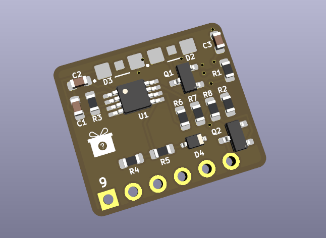
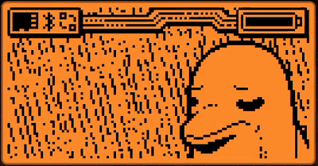

# Pokémon Mystery Gift over IR (Flipper Zero) — IR mini fork

Send a Pokémon **Gen II** (Gold/Silver/**Crystal**) *Mystery Gift* to a real Game
Boy Color cartridge using the Flipper Zero and a small external IR front end on
the GPIO header.

This is a fork of
**[TheRealNox/flipper-pokemon-mystery-gift](https://github.com/TheRealNox/flipper-pokemon-mystery-gift)**
. The protocol work, the receiver port, the HAL and the original
app are his; see [Credits](#credits). This fork moves the IR pins to a compact
"IR mini" add-on board and finishes the items his README listed as ideas:
decoration gifts, showing the partner data the cart sends back, and
capture-and-replay. It also adds a random-gift mode and reorganises the menus.

> **Status of upstream:** Nox verified the full two-pass exchange against a real
> French Pokémon Crystal cartridge on 2026-07-19 (gift delivered and accepted,
> partner data and party received back, checksums clean). The receiver logic is
> a faithful port of the proven projectpokemon Raspberry Pi implementation. Full
> technical rationale is in **[DESIGN.md](DESIGN.md)**.
>
> **Status of this fork:** builds clean on official firmware 1.4.3 with `ufbt`
> and runs on the Flipper, but is **not yet tested against a cartridge**. The
> IR mini boards have not been built. Treat everything below the hardware
> section as unverified until that happens.

## Why external hardware?

The GBC IR port is **un-modulated** (no 38 kHz carrier). The Flipper's onboard
IR receiver is a demodulating TSOP and is physically blind to it, so the app
bypasses `furi_hal_infrared` entirely and bit-bangs two GPIO pins against an
external IR LED (TX) and photodiode + transimpedance-amp receiver (RX). See
DESIGN.md §3 for the circuit and the reasoning behind it.

Two things Nox points out that still apply here:

- **A TV remote won't work as an RX test source** (it is modulated). Loop your
  own TX LED back into your own RX sensor, or use another Flipper's TX.
- **The receiver output is inverting** (light → line LOW) and is **polled**, not
  interrupt driven, so the RX pin must not be shared with a key or subsystem.

### IR mini pin map (this fork)



The IR mini board is a 6-pin header plug on pins 9–14. The app disables the
expansion-module service and takes USART1 while it runs so that pins 13/14 are
free, and gives them back on exit.

| Signal | Header pin | Firmware symbol |
|---|---|---|
| Board Vcc (op-amp + LED) | 9 (3V3) | — |
| GND | 11 | — |
| IR TX (LED driver) | 13 | `gpio_usart_tx` (PB6) |
| IR RX (receiver out) | 14 | `gpio_usart_rx` (PB7) |

The board runs from 3.3 V only; OTG 5 V is off (`enable_otg_5v = false`).

To use Nox's original protoboard instead, change `tx_pin`/`rx_pin` in
`gbc_ir_hal.c` back to `gpio_ext_pa7` (pin 2) and `gpio_ext_pc0` (pin 16) and
remove the USART acquire; DESIGN.md still documents that wiring.

## Build & flash

Uses [`ufbt`](https://github.com/flipperdevices/flipperzero-ufbt). Built and
installed on official firmware 1.4.3; Nox developed on Momentum.

```sh
pip install --upgrade ufbt
ufbt update --channel=release        # or the SDK channel matching your firmware
ufbt                                  # build -> dist/pokemon_mystery_gift.fap
ufbt launch                           # build, install, and start on the Flipper
```

The app installs under **GPIO** as *Pokemon Mystery Gift*. Logs: `ufbt cli`
then `log`, or read the on-screen log. The last exchange's flight recorder is
written to `apps_data/pokemon_mystery_gift/last_trace.txt` on the SD card.

## Bring-up ladder (from upstream)

Each rung needs only the previous hardware, so you can debug incrementally.
TX Test and RX Monitor live under **Diagnostics**.

1. **TX Test** → scope pin 13 (or the LED cathode). Confirm hello =
   `126 µs mark / 537 µs space / 126 µs mark`, and data bits match §2.2 of
   DESIGN.md. Tune the constants in `mg_timing.h` if needed.
2. **RX Monitor** → point an un-modulated IR source at the sensor and confirm
   sane `mark=/space=` widths. Point your TX LED at your own RX sensor to loop
   back.
3. **Hello handshake** → put the game on the Mystery Gift screen, run **Send
   Gift**, and confirm the cart leaves the "Press A" screen (it detected us).
4. **Single block + ACK** → watch the log for a successful `0x6C` ACK.
5. **Full gift** → the item appears at the Goldenrod Pokémon Center counter.

## Using the app



*Menu walkthrough recorded on the Flipper: Send Gift (Item / Decoration /
Random), Send Captured, Settings, Diagnostics and About. Full-quality
recording: [docs/app-walkthrough.mp4](docs/app-walkthrough.mp4).*

### Send Gift

- **Gift** — *Item*, *Decoration* or *Random*.
  - *Item* shows an **Item** row: left/right cycles the 37 giftable items
    (Berry … Rare Candy … Mail).
  - *Decoration* shows a **Decoration** row over the game's 37-entry
    `MysteryGiftDecos` table (dolls, posters, consoles, beds, carpets, plants).
    A decoration the cart already owns falls back to the item, as in the game.
  - *Random* picks item-or-decoration, the gift, **and a fresh trainer name and
    ID** on every send. The game allows one gift per partner ID per day, so
    this lets you hand out several gifts in a row. The send screen shows
    `Gift: ???` so the surprise is kept until the Pokémon Center reveals it;
    the name used is logged as `As: <name>`.
- **Send gift** — press OK to start the exchange.

After a successful exchange the log prints what the cart sent back: trainer
name and ID, Pokédex count, the gift it offered, and its party as level +
species.

### Send Captured

The partner payloads from the last successful exchange are saved to
`apps_data/pokemon_mystery_gift/capture.bin` and survive restarts. **Send
Captured** transmits them again byte for byte, with the "friend ready" flag
and the daily counter cleared, so another game receives exactly the trainer
and gift that cart offered.

### Settings

- **Region** — USA / France / Germany / Italy / Spain (the target cart's
  region). The cart answers with its own region code during the handshake and
  the log prints it, so if a send fails check that line first.
- **Trainer** — press OK to type the trainer name (Gen II charset, up to 10
  chars).
- **Trainer ID** — press OK to edit the 2-byte ID in hex.
- **Random ID/send** — On/Off. When On, a fresh random ID is used on every
  send. Ignored in Random gift mode, which always randomises.

Defaults: region USA, first item (Berry), first decoration (Jigglypuff Doll),
name `FLIPPER`, random ID on. They are set in `app_alloc()` in
[`pokemon_mystery_gift.c`](pokemon_mystery_gift.c).

### Diagnostics / About

**Diagnostics** holds TX Test and RX Monitor. **About** shows the pin map and
whether a capture is present.

## Files

| File | Role |
|---|---|
| `gbc_ir_hal.{c,h}` | raw bit-bang IR HAL (Nox; pins and USART handling changed here) |
| `mg_timing.h` | protocol timings + byte constants (Nox) |
| `mg_protocol.{c,h}` | messages, blocks, ACK, hello, sender state machine + flight recorder (Nox; now keeps the partner payloads) |
| `mg_gift.{c,h}` | payload builder, Gen II text encode/decode, decoration table, partner-data parsers |
| `mg_species.{c,h}` | Gen II species names, generated from pokecrystal |
| `pokemon_mystery_gift.c` | app entry, GUI, worker thread |

## Still open

- Test the whole thing against a cartridge with the IR mini board.
- Upstream was tested only against French Crystal and Gold carts. Silver and
  other regions should work (region is auto-detected) but are unverified.

## Credits

The original app, HAL, protocol port and design document are by
**Nicolas Aubry ([TheRealNox](https://github.com/TheRealNox))**. His project in
turn stands on prior reverse-engineering work:

- **[projectpokemon "Mystery Gift: Reverse Engineering of IR Protocol" thread](https://projectpokemon.org/home/forums/topic/43930-mystery-gift-reverse-engineering-of-ir-protocol/)**
  — the original protocol RE, the receiver schematic, and the working Raspberry
  Pi reference implementation (`mysterygift.c`). The RX logic is a faithful port
  of that code; timing/thresholds were re-calibrated for the analog front end.
- **[pret/pokecrystal](https://github.com/pret/pokecrystal)** — the Gen II
  disassembly, used to verify the exact payload byte layouts, the
  item/decoration index tables, species names, checksum, and the handshake
  choreography.
- **[kbembedded/Flipper-Zero-Game-Boy-Pokemon-Trading](https://github.com/kbembedded/Flipper-Zero-Game-Boy-Pokemon-Trading)**
  ([issue #29](https://github.com/kbembedded/Flipper-Zero-Game-Boy-Pokemon-Trading/issues/29))
  — framing of the problem and why the Flipper's onboard IR can't do it.

Fork changes (IR mini pins, decorations, partner display, capture/replay,
random gifts, menu layout) by Jack.

## License

GPL-3.0-or-later. See [LICENSE](LICENSE). Portions of the receive logic are
derived from the community reference implementation cited above.
